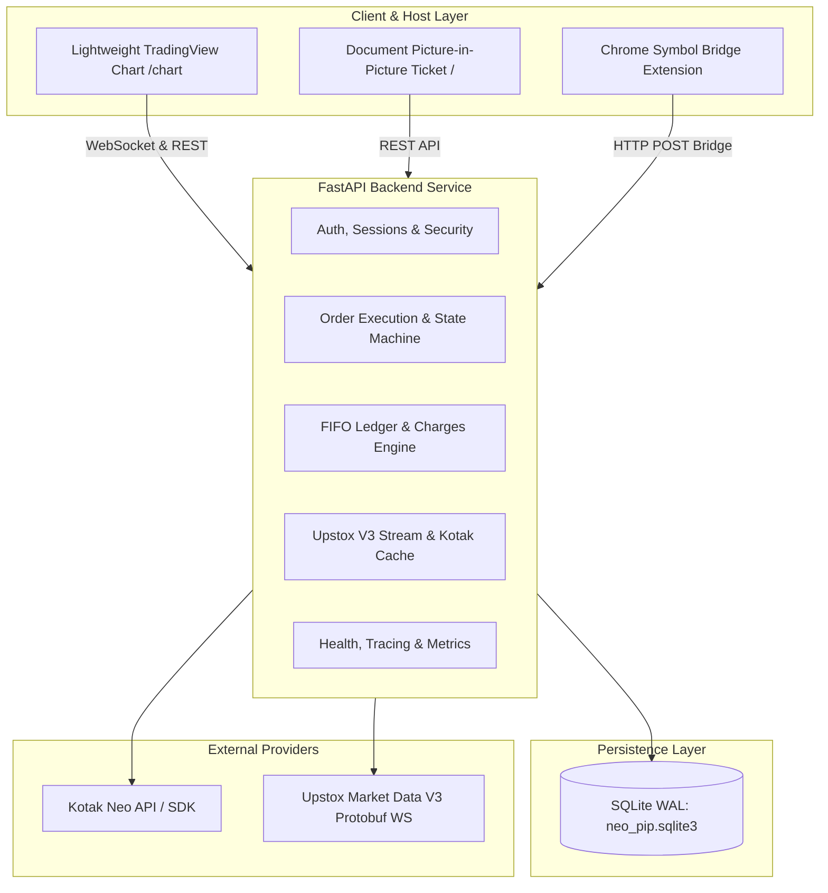

# Master Architecture Audit
**Project:** Kotak Neo PIP Trading Terminal  
**Date:** November 11, 2026  
**Auditor:** Principal Software & Quantitative Systems Architect  
**Scope:** Full-stack architecture, backend FastAPI, frontend chart/trading interface, local SQLite database, Kotak Neo SDK bridge, Chrome extension symbol bridge, and live streaming services.

---

## 1. Executive Summary
The Kotak Neo PIP Trading Terminal is a single-operator specialized algorithmic & manual trading terminal designed for Indian index options/equities (via Kotak Neo broker & Upstox market data) and Forex paper trading.

While functionally rich (with lightweight interactive charts, multi-chart PIP views, SL/TP rules, and Upstox V3 streaming), the system historically evolved into a large monolithic structure:
- `app/main.py` has grown into an ~8,100-line monolithic server file combining API routing, Kotak Neo SDK execution, broker limits normalization, Upstox WebSocket decoding, user authentication, SQLite ORM queries, and order management.
- `app/accounting.py` (~940 lines) provides a robust FIFO position matching engine, statutory charges calculator, and ledger rebuilder.
- `app/static/chart.js` (~7,840 lines) and `app/static/app.js` (~2,400 lines) handle frontend charting, Document Picture-in-Picture lifecycle, order tickets, and trade management.

---

## 2. Component Architecture & System Topology

---

## 3. High-Priority Architectural Findings

### Finding ARCH-01: Monolithic Application Structure
- **Location:** `app/main.py`
- **Issue:** 70+ endpoints, auth middleware, WebSocket feed parsers, broker SDK wrappers, and background tick schedulers reside in a single file.
- **Risk:** High cognitive load, tight coupling, elevated risk of regression during bug fixes.
- **Remediation Strategy:** Introduce clean modular abstractions:
  1. Centralized structured logging and correlation middleware.
  2. Strict order state machine constants and validation handlers.
  3. Isolated diagnostics, health, and security middleware.
  4. Preserve all existing route signatures and response contracts.

### Finding ARCH-02: Missing Request Correlation & Structured Logging
- **Location:** `app/main.py:189-198`, throughout route handlers
- **Issue:** Uses ad-hoc `print()` and standard `audit()` calls without standard log levels, structured JSON logging, or `X-Request-ID` correlation across HTTP and WebSocket pipelines.
- **Risk:** Inability to correlate live order anomalies or broker rejection traces with specific user requests.
- **Remediation:** Implement standard request correlation ID middleware (`X-Request-ID`) and a structured logger.

### Finding ARCH-03: Order State Machine Incompleteness
- **Location:** `app/main.py:949-965`, `app/main.py:1354-1420`, `app/main.py:3221-3368`
- **Issue:** Orders are stored mainly as `submitted`, `completed`, `pending`, `cancelled`, or `rejected`. Ambiguous broker timeouts or transport disconnections are logged as `live_order_ambiguous_or_failed` but do not persist an explicit `UNKNOWN` or `RECONCILIATION_REQUIRED` order state in SQLite.
- **Risk:** If a network blip occurs after `place_order` was received by Kotak but before HTTP response delivery, the local order row remains unrecorded or marked failed, leaving open exposure without tracking.
- **Remediation:** Introduce pre-submission state recording (`CREATED` / `SUBMITTED`), capture broker order IDs atomically, and mark ambiguous outcomes as `UNKNOWN` / `RECONCILIATION_REQUIRED` with automated reconciliation sync.

### Finding ARCH-04: Database Connection Lifecycle & Concurrency
- **Location:** `app/main.py:80-84`
- **Issue:** `db()` helper opens and closes ad-hoc SQLite connections on every query with a 10s timeout. While SQLite with WAL mode is adequate for single-user local trading, foreign key enforcement is not explicitly enabled (`PRAGMA foreign_keys = ON;`).
- **Risk:** Potential orphan rows in `position_lots`, `position_matches`, or `charges` if manual deletes occur.
- **Remediation:** Enable WAL mode and `PRAGMA foreign_keys = ON;` in database initialization, add explicit composite indexes for order queries and status lookups.

### Finding ARCH-05: Picture-in-Picture (PIP) Lifecycle Safety
- **Location:** `app/static/app.js:154-210`, `app/static/chart.js`
- **Issue:** Document Picture-in-Picture opens an auxiliary window duplicating document DOM. Closing the PIP window triggers `pagehide`, which cleanly unhooks listeners, but if WebSocket or pending state requests were mid-flight, no cancellation or broker disruption occurs.
- **Remediation:** Explicitly guard PIP termination so that background broker trading sessions and running stop-loss rules on the backend remain uninterrupted.

---

## 4. Architectural Scorecard
| Layer | Current Status | Target Architecture |
|---|---|---|
| **Backend API** | Monolithic, mixed concerns | Modularized services, structured logging, request correlation |
| **Order Engine** | Synchronous with lock, partial states | Formal 12-state state machine, intent-first persistence, auto-reconcile |
| **Persistence** | SQLite WAL, implicit foreign keys | Strict WAL, foreign keys enabled, indexed queries, migration tracking |
| **Market Data** | Hybrid Upstox V3 WS + REST fallback | Persistent heartbeat, stale feed detection, sub-10ms cache |
| **Auth & Security** | Token in header/cookie, open CORS | Tightened CORS origin check, rate limiting, brute-force lockout |
| **Client PIP** | Document PiP + popup fallback | Preserved with safe unbind and persistent backend state |
