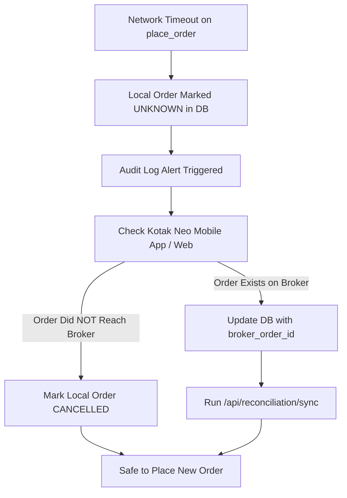

# Disaster Recovery & Incident Response Runbook
**Project:** Kotak Neo PIP Trading Terminal  
**Classification:** Financial Transaction & Execution Recovery

---

## 1. Incident Classification & Response Matrix

| Severity | Incident Description | Action Required | Escalation / RTO |
|---|---|---|---|
| **P1 - CRITICAL** | Order submission timeout / Ambiguous broker response | DO NOT RETRY ORDER. Mark order `UNKNOWN`. Open Kotak Neo app/order book. Reconcile via `/api/reconciliation/sync`. | $< 60\text{ seconds}$ |
| **P1 - CRITICAL** | Disconnection during open position | Trigger Emergency Exit via Kotak Neo mobile app or call Kotak dealing desk. | Immediate |
| **P2 - HIGH** | Upstox market data feed freezes or drops | System falls back to REST V3 quotes. Restart WebSocket via `/api/chart/upstox-token`. | $< 2\text{ minutes}$ |
| **P2 - HIGH** | Kotak session error 100008 (Unauthorized / IP Mismatch) | Check current public IP via `/api/egress-ip`. Update Kotak whitelist and re-authenticate. | $< 5\text{ minutes}$ |
| **P3 - MEDIUM** | SQLite database corruption | Restore from hourly WAL snapshot in `/app/data/`. | $< 10\text{ minutes}$ |

---

## 2. Ambiguous Order Resolution Procedure (Golden Rule)

> **CRITICAL RULE:** NEVER automatically re-submit an order that failed due to a network timeout or connection reset.



---

## 3. Database Backup & Restore

### Automated Backup Script
```bash
#!/bin/bash
BACKUP_DIR="/opt/neo-pip-terminal/backups"
mkdir -p "$BACKUP_DIR"
sqlite3 /opt/neo-pip-terminal/data/neo_pip.sqlite3 ".backup '$BACKUP_DIR/neo_pip_$(date +%Y%m%d_%H%M%S).sqlite3'"
# Retain last 7 days of backups
find "$BACKUP_DIR" -type f -name "*.sqlite3" -mtime +7 -delete
```

### Recovery Procedure
```bash
# 1. Stop backend container
docker stop neo-pip-backend

# 2. Restore database from latest clean snapshot
cp /opt/neo-pip-terminal/backups/neo_pip_YYYYMMDD_HHMMSS.sqlite3 /opt/neo-pip-terminal/data/neo_pip.sqlite3

# 3. Rebuild accounting ledger
# Start container
docker start neo-pip-backend
# Trigger ledger reconciliation
curl -X POST http://127.0.0.1:8000/api/reconciliation/rebuild -H "Authorization: Bearer <ADMIN_TOKEN>"
```
