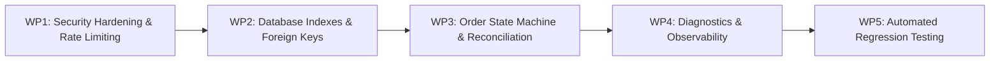

# Implementation Plan: Production Hardening
**Project:** Kotak Neo PIP Trading Terminal  
**Date:** November 11, 2026  
**Execution Methodology:** Incremental Test-Driven Implementation (Non-Destructive)

---

## 1. Architectural Principles
1. **Never break existing features:** All existing endpoints, charting logic, drawing tools, and Kotak SDK flows must remain 100% operational.
2. **Paper trading default:** Live trading remains disabled unless explicitly toggled in `.env` and authenticated.
3. **No fabricated data:** Live quotes, fills, and broker states reflect true source state.
4. **Automated verification:** Every change must be verified with automated pytest suites, JavaScript syntax checks, and regression passes.

---

## 2. Implementation Work Packages

### Work Package 1: Security & Credential Hardening
- Eliminate fallback plaintext credentials (`ADMIN_PASSWORD = "..."`, `OWNER_PIN = "..."`). If `.env` is unconfigured, generate cryptographically secure ephemeral tokens.
- Implement an in-memory sliding-window IP/Account rate limiter (`RateLimiter`) for `/api/auth/*` endpoints to thwart credential stuffing and brute-force attacks.
- Strict CORS policy: Replace permissive wildcard reflection with a whitelist of authorized origins (`neo-pip-terminal.vercel.app`, `localhost:8000`, `127.0.0.1:8000`, and `ALLOWED_ORIGINS`).
- Attach standard security headers (`X-Content-Type-Options`, `X-Frame-Options: SAMEORIGIN`, `Referrer-Policy`) to all HTTP responses.

### Work Package 2: Database Schema & Migration Hardening
- Explicitly enforce `PRAGMA foreign_keys = ON;` and `PRAGMA journal_mode = WAL;`.
- Add missing database indexes:
  - `idx_orders_broker_id` on `orders(broker_order_id)`
  - `idx_orders_status` on `orders(status)`
  - `idx_executions_acc_inst` on `executions(account_id, instrument_key)`
  - `idx_position_matches_pos` on `position_matches(position_id)`
  - `idx_charges_exec` on `charges(execution_id)`

### Work Package 3: Order State Machine & Broker Safety Hardening
- Formalize order state lifecycle:
  `CREATED` $\to$ `VALIDATING` $\to$ `SUBMITTED` $\to$ `ACKNOWLEDGED` $\to$ `OPEN` $\to$ `FILLED` / `PARTIALLY_FILLED` / `CANCELLED` / `REJECTED` / `UNKNOWN` / `RECONCILIATION_REQUIRED`.
- **Pre-submission Intent Recording:** Persist order intent in database before initiating network call to Kotak Neo SDK.
- **Ambiguous Timeout Safety:** If a transport timeout or network exception occurs, mark the order `UNKNOWN` / `RECONCILIATION_REQUIRED` instead of discarding, and prevent auto-retrying.
- Link automated reconciliation endpoint (`/api/reconciliation/sync`) to check broker tradebook and resolve `UNKNOWN` orders.

### Work Package 4: Observability, Feed Health & Diagnostics
- Introduce structured JSON logging with request correlation (`X-Request-ID`).
- Implement `/api/admin/diagnostics` providing system metrics:
  - WebSocket feed health (last tick timestamp, stale indicator)
  - Active memory & CPU runtime metrics
  - Broker session validity & egress IP
  - Open positions count & database query latency
- Feed staleness detector: In `/api/chart/live-quote` and WebSocket streaming, flag ticks older than 5 seconds with `"is_stale": true`.

### Work Package 5: Test Automation Suite & Final Verification
- Add comprehensive pytest tests:
  - Rate limiting & brute-force rejection tests.
  - CORS security header tests.
  - Pre-submission order intent & UNKNOWN timeout tests.
  - FIFO matching edge cases (buy-sell, multi-lot partials, reversals).
  - Diagnostics API status tests.
- Re-run all existing 75 unit/integration tests to ensure zero regressions.
