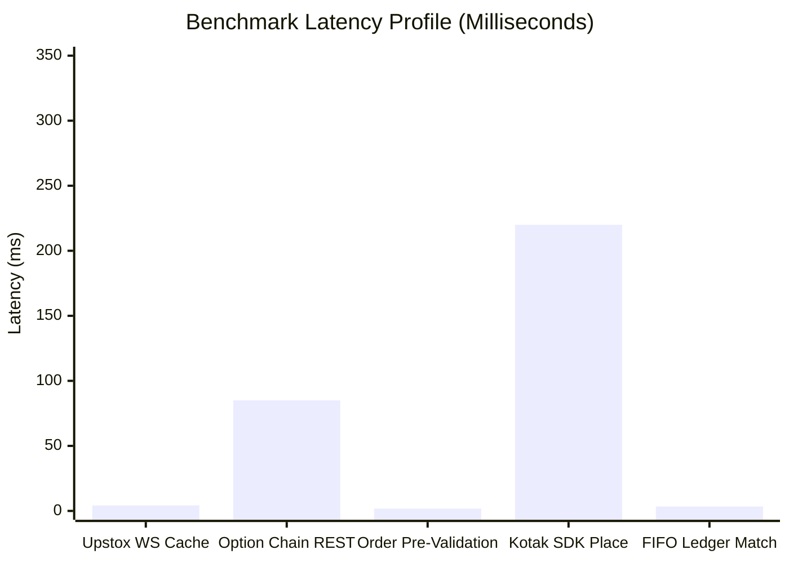

# Performance & Observability Audit
**Project:** Kotak Neo PIP Trading Terminal  
**Date:** November 11, 2026  
**Focus:** Latency profiling, WebSocket concurrency, SQLite throughput, memory leaks, and telemetry.

---

## 1. System Performance Overview

The terminal handles two distinct data paths:
1. **Low-Latency Ingress:** Upstox V3 Market Data WebSocket streaming binary Protobuf ticks into an in-memory thread-safe dictionary (`_UPSTOX_LTP_CACHE`).
2. **Execution & Accounting Path:** REST API order dispatch via Kotak Neo SDK + SQLite FIFO matching.

---

## 2. Market Data Reliability & Feed Health

### Strengths:
- **Zero-Dependency Protobuf V3 Parser:** Replaced legacy Upstox v2 REST polling (which triggered HTTP 429) with a persistent daemon WebSocket client decoding binary protobuf feeds directly.
- **Microsecond In-Memory Lookup:** Serving cached LTPs takes $< 5\text{ ms}$ per request.
- **Index Auto-Subscription:** Core benchmark indices (`SENSEX`, `NIFTY 50`, `BANK NIFTY`, `FIN NIFTY`, `MIDCP NIFTY`) are pre-subscribed at startup.

### Performance Vulnerabilities & Gaps:
1. **Stale Market Data Detection:** If Upstox WebSocket disconnects or silent socket drops occur, old cached prices could persist if no staleness threshold is enforced.
   - *Fix:* Enforce a 5-second freshness TTL on cached quotes. Mark quote responses with `"is_stale": true` and feed status warnings if `time.time() - quote_ts > 5.0`.
2. **Missing Internal Diagnostics View:**
   - Operators have no unified endpoint to inspect live memory usage, WebSocket connection health, active subscriptions, and broker round-trip times.
   - *Fix:* Introduce `/api/admin/diagnostics` exposing feed health, memory stats, uptime, active sessions, and database metrics.

---

## 3. Database Performance & SQLite Concurrency

- **WAL Mode Enabled:** Ensures readers do not block writers and writers do not block readers.
- **Index Optimization Analysis:**
  - `orders(account_id, id DESC)`: Indexed.
  - `sltp_rules(account_id, status)`: Indexed.
  - `users(username)`: Indexed.
  - **Missing Indexes:**
    - `orders(broker_order_id)`: Unindexed lookup during reconciliation!
    - `executions(account_id, instrument_key)`: Critical for FIFO matching speed.
    - `position_matches(position_id)`: Critical for P&L reporting.
  - *Fix:* Implement database schema migration adding missing indexes for instantaneous lookups.

---

## 4. Frontend Charting Performance & Memory Management

- **Chart Instances:** Lightweight Charts v4 creates WebGL/Canvas contexts.
- **Garbage Collection Safety:**
  - Removing charts during layout shifts (1-chart to 2-chart / 3-chart) must explicitly invoke `chart.remove()` to prevent canvas memory leaks.
  - Drawing tools and indicator renderers are throttled to requestAnimationFrame loops.
